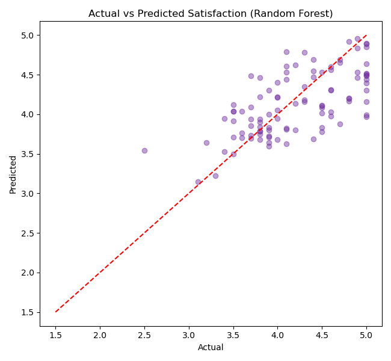
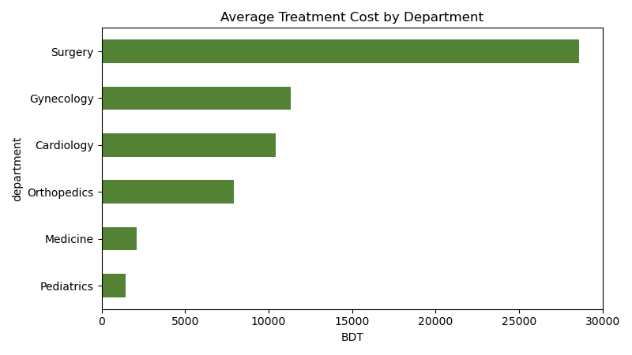
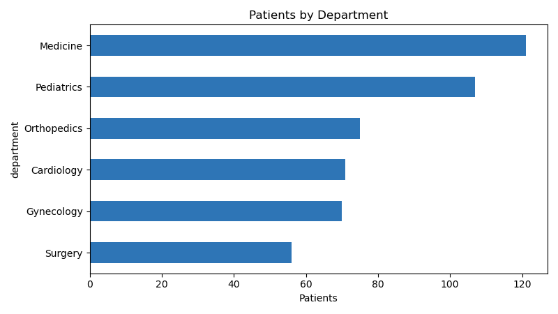
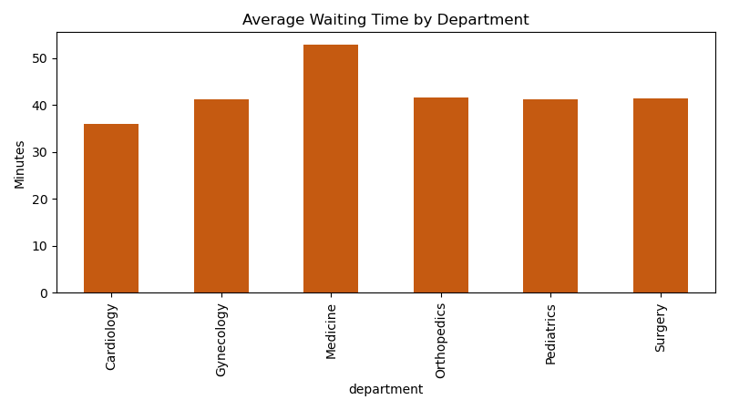
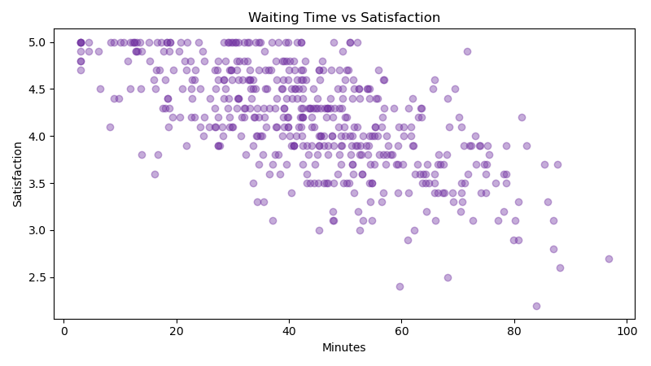

# 🏥 Hospital Patient Analysis

Analyzing 500 hospital patients — departments, waiting times, treatment costs and satisfaction.

A complete beginner-friendly Data Science project built with **Python, Pandas, NumPy, Matplotlib and scikit-learn**.
The dataset (500 patients) is synthetic — generated with a fixed NumPy seed so anyone can reproduce it exactly.

## What's inside
- `src/generate_dataset.py` — creates the dataset in `data/`
- `src/analysis.py` — full analysis: summary tables, charts and insights
- `src/ml_model.py` — Machine Learning: trains and compares 2 prediction models
- `hospital-patient-analysis.ipynb` — Jupyter notebook version of the analysis
- `outputs/charts/` — 4 charts · `outputs/tables/` — 4 summary tables · `outputs/insights.md` — key findings
- `PROJECT_GUIDE.md` — a full beginner-friendly explanation of everything in this project

## How to run
```bash
pip install -r requirements.txt
python src/generate_dataset.py
python src/analysis.py
```

## Dataset columns
| Column | Meaning |
|---|---|
| date | Visit date |
| department | Hospital department |
| age | Patient age |
| gender | Female / Male |
| visit_type | OPD / Emergency / Follow-up |
| wait_time_min | Waiting time in minutes |
| treatment_cost_bdt | Treatment cost in BDT |
| satisfaction | Patient satisfaction (1–5) |

# Key Insights — Hospital Patient Analysis

- Dataset: 500 patients across 6 departments.
- Busiest department: **Medicine**.
- Longest average wait: **Medicine** (52.8 minutes).
- Correlation between waiting time and satisfaction: **-0.64** (longer waits, lower satisfaction).
- Average treatment cost: **8,273 BDT**; most expensive department on average: **Surgery**.


## Machine Learning — prediction model
Predict patient satisfaction (1–5) from age, waiting time, treatment cost, department and visit type.

| Model | R² / Accuracy | RMSE |
|---|---|---|
| Linear Regression | 0.507 | 0.39 points |
| Random Forest | 0.409 | 0.42 points |

**Best model: Linear Regression.** Linear Regression predicts satisfaction within about **0.39 points** on a 5-point scale (R² = 0.507) — satisfaction depends heavily on waiting time, which acts almost linearly.

Run it yourself: `python src/ml_model.py` (needs scikit-learn, already in `requirements.txt`).
Results are saved in `outputs/tables/model_results.csv`.



## Charts




